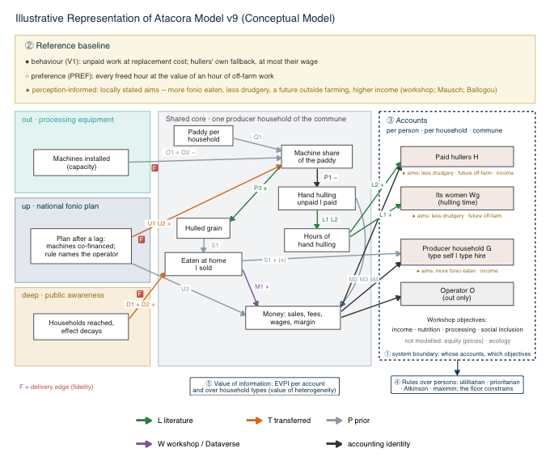

# Scaling as a valuation decision: valuation functions and the Atacora case model

Code and documentation for the article *Scaling as a valuation decision: making justice trade-offs visible in decision analysis for opportunity crops* (Daniel Rozeik, in preparation).

## What this is

**Valuation functions** (`R/`). Sixteen small functions in base R. They take the result of a Monte Carlo simulation, for example from the R package [decisionSupport](https://CRAN.R-project.org/package=decisionSupport), and show how a result depends on choices that data cannot settle: which effects count, what outcomes are compared with, for whom a number is reported, how groups are weighed against each other, and whose decision new information would serve. They are general and contain no case data.

**The Atacora case model.** An illustrative model of scaling fonio (*Digitaria exilis*) processing in Atacora, northern Benin, which applies the functions. It compares processing equipment, advocacy for a national fonio plan and a nutrition campaign with the status quo. It shows why the choices above have to be examined; it gives no recommendation for Atacora. Every result holds under the assumptions in the input table.



## How this relates to the article

| In the article | Here |
|---|---|
| Section 3, the five design axes and their implementation | [`FUNCTIONS.md`](FUNCTIONS.md), `R/` |
| Appendix 1 (supplementary material) | the same text as [`FUNCTIONS.md`](FUNCTIONS.md); source of the appendix file: `docs/91-functions.qmd` |
| Section 4, the Atacora tests of hypotheses H1–H4 | `atacora_DA_model.R`, `atacora_DA_axes_full.R`, run with `atacora_DA_run.R` |

The article itself is not part of this repository.

## Where to find what

| You want to … | Go to |
|---|---|
| understand the functions with one small example | [`FUNCTIONS.md`](FUNCTIONS.md) · Deutsch: [`FUNCTIONS.de.md`](FUNCTIONS.de.md) |
| run that example | `examples/complete_analysis.R`, `examples/step_by_step.R` |
| use the functions on your own model | `load.R`, then *Quick start* below |
| see all five axes applied to a real model in under 100 lines | `atacora_DA_axes.R` |
| read the model | `atacora_DA_model.R`; line by line at the medians: `docs/model_walkthrough.md`; a reading path: `docs/review_checklist.md` |
| check where an input comes from | `data/estimates/atacora_DA_inputs_v8.csv` |
| reproduce the numbers in Section 4 | *Reproduce* below |
| see how the code is tested | `tests/testthat/` |

## Quick start

```r
source("load.R")
nb <- nb_from_mc(mc, "NB_{group}_{option}", groups = c("a", "b"), options = c("sq", "x"))
fairness_screen(nb, p = c(a = 0.7, b = 0.3),
                rules = list(utilitarian = w_utilitarian(), maximin = w_maximin()))
```

`mc` is the result of your own `mcSimulation()`. Its output needs one column per group and option. All groups must come from the same draws.

## Reproduce

```sh
Rscript --vanilla atacora_DA_run.R
```

Runs the tests, then the model (10,000 draws, seed 20260927), the full case analysis, the key findings and the figures; about 25 minutes. Results are written to `outputs/v9/` and are not versioned. `atacora_DA_axes.R` then gives the five axes at a glance from the saved draws. Package versions are in `renv.lock`; `renv::restore()` installs them.

## Input table

One row per uncertain input: distribution, lower and upper bound, label, description, source (`source_key`, `source_anchor`), status, note, the model edge it acts on, and the method of derivation. Status codes: **L** literature, **W** workshop or published dataset, **T** transferred from another region (only for up and deep, with wider bounds), **B** open request to project partners (runs as a broad prior), **P** wide prior set deliberately. Raw data are not part of this repository; every row names its source.

## Author and licence

Daniel Rozeik, University of Bonn. A licence and a citable archived version will be added when the repository is made public.
