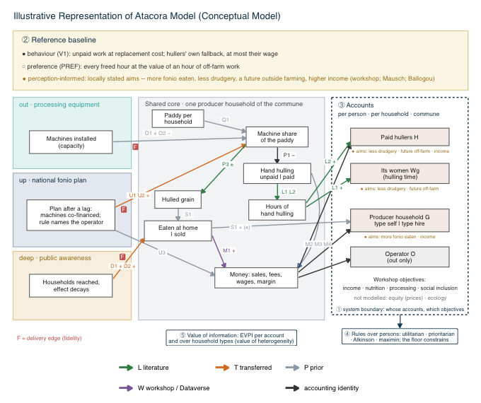

# Scaling as a valuation decision: valuation functions and the Atacora case model

Code and documentation for the article *Scaling as a valuation decision: making justice trade-offs visible in decision analysis for opportunity crops* (Daniel Rozeik, in preparation).

**Start here:** [`FUNCTIONS.md`](FUNCTIONS.md) explains every function with one small example · Deutsch: [`FUNCTIONS.de.md`](FUNCTIONS.de.md)

## What this is

**Valuation functions** (`R_functions/`). Sixteen small functions in base R. They take the result of a Monte Carlo simulation, for example from the R package [decisionSupport](https://CRAN.R-project.org/package=decisionSupport), and show how a result depends on choices that data cannot settle: which effects count, what outcomes are compared with, for whom a number is reported, how groups are weighed against each other, and whose decision new information would serve. They are general and contain no case data.

**The Atacora case model** (`R_model/`). An illustrative model of scaling fonio (*Digitaria exilis*) processing in Atacora, northern Benin, which applies the functions. It compares processing equipment, advocacy for a national fonio plan and a nutrition campaign with the status quo. It shows why the choices above have to be examined; it gives no recommendation for Atacora. Every result holds under the assumptions in the input table.



## Where to find what

| You want to … | Go to |
|---|---|
| understand the functions | [`FUNCTIONS.md`](FUNCTIONS.md) · [`FUNCTIONS.de.md`](FUNCTIONS.de.md) |
| run the guide's example | [`examples/complete_analysis.R`](examples/complete_analysis.R) |
| use the functions on your own model | [`load.R`](load.R), then *Quick start* below |
| read the model | [`R_model/atacora_DA_model.R`](R_model/atacora_DA_model.R) |
| see the five axes applied to the model | [`R_model/atacora_DA_axes.R`](R_model/atacora_DA_axes.R) (under 100 lines) |
| check where an input comes from | [`data/atacora_DA_inputs.csv`](data/atacora_DA_inputs.csv) |

## How this relates to the article

| In the article | Here |
|---|---|
| Section 3.6 and Appendix 1: the functions and their equations | [`FUNCTIONS.md`](FUNCTIONS.md), [`R_functions/`](R_functions/) |
| Section 4: every number and the results figure | [`R_model/atacora_DA_axes.R`](R_model/atacora_DA_axes.R), run on the draws of [`R_model/atacora_DA_model.R`](R_model/atacora_DA_model.R) |

The Atacora tests call the functions of `R_functions/` unchanged; nothing in `R_model/` redefines them. The article itself is not part of this repository.

## Quick start

```r
source("load.R")
nb <- nb_from_mc(mc, "NB_{group}_{option}", groups = c("a", "b"), options = c("sq", "x"))
fairness_screen(nb, p = c(a = 0.7, b = 0.3),
                rules = list(utilitarian = w_utilitarian(), maximin = w_maximin()))
```

`mc` is the result of your own `mcSimulation()`. Its output needs one column per group and option. All groups must come from the same draws.

## Reproduce

The case analysis requires `decisionSupport` and `pls` (for the sensitivity analysis). Install them once in R; their required dependencies are installed automatically:

```r
install.packages(c("decisionSupport", "pls"), repos = "https://cloud.r-project.org")
```

The checked run used R 4.6.0, `decisionSupport` 1.115 and `pls` 2.9-0.

From the project folder (in RStudio: open `scalingatacora.Rproj`):

```r
source("R_model/atacora_DA_model.R")   # 10,000 draws, seed 20260927; saves them to outputs/ (about 10 minutes)
source("R_model/atacora_DA_axes.R")    # the five axes on the saved draws; results in `screen`
```

The numbers reported in Section 4 of the article come from `screen`. The model needs the R package [decisionSupport](https://cran.r-project.org/package=decisionSupport); the functions need base R only. The package versions of the reported run are recorded in `renv.lock`.

## Input table

One row per uncertain input: distribution, lower and upper bound, label, description, source (`source_key`, `source_anchor`), status, note, the model edge it acts on, and the method of derivation. Status codes: **L** literature, **W** workshop or published dataset, **T** transferred from another region (only for up and deep, with wider bounds), **B** open request to project partners (runs as a broad prior), **P** wide prior set deliberately. Raw data are not part of this repository; every row names its source.

## Author and licence

Daniel Rozeik, University of Bonn. 
Copyright (C) 2026 Daniel Rozeik. Licensed under the GNU General Public License v3.0, the same license as decisionSupport (see LICENSE).
